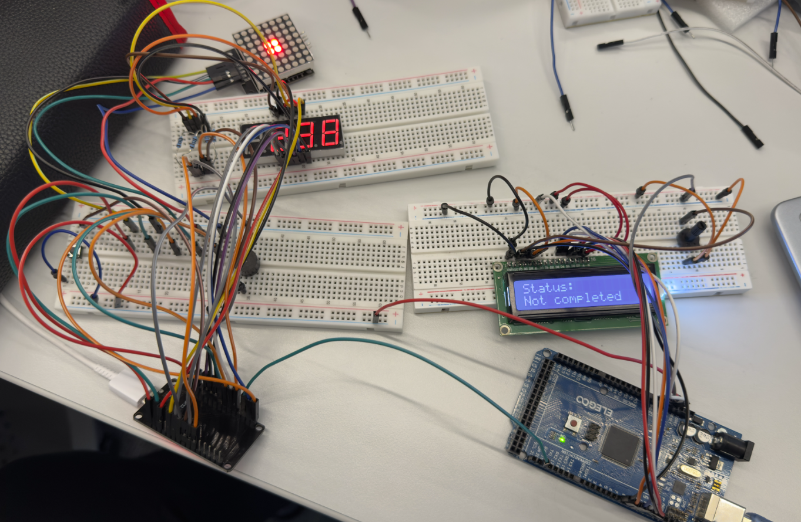

# Embedded-Medical-Reminder-System
Arduino and ESP32-based medical reminder system developed (in ONE morning) during the Medtronic Hackathon to support post-surgery recovery. Uses an LCD, LED matrix, passive buzzer, and push button for visual/audio reminders and task confirmation. Demonstrates Embedded C++, microcontroller communication, hardware integration, and digital I/O.

## Demo Video

Watch the project in action: [Medical Reminder System Demo](https://youtube.com/shorts/JFz9XWkBTls)

## Project Purpose
The goal of this project is to make post-surgical recovery easier and more accessible by helping patients stay on top of their daily recovery tasks. The physical reminder system provides a simple alternative for patients who may have difficulty navigating software-based recovery platforms.

## Features
- LCD display for daily recovery tasks and reminders
- LED matrix for visual task status indicators
- Passive buzzer for audible reminders
- Push button for confirming task completion
- Communication between Arduino and ESP32 microcontrollers
- Interactive visual feedback based on task completion
- Accessible hardware interface for patients

## Hardware Components
- Arduino Uno
- ESP32
- LCD display
- LED matrix
- Passive buzzer
- Push button
- Potentiometer
- 1000 OHM Resistors
- Breadboard
- Jumper wires

## How It Works
- The LCD displays a status of "Completed" or "Not Completed"  based on what the patient sets it to.
- The LED matrix provides a visual indication of the current task status with a check mark design or circle to dot design.
- The passive buzzer generates an audible alert that changes frequency based on mode its set to.
- Once the patient completes the task, they press the push button to confirm completion.
- The microcontrollers communicate to update the system's task completion status.
- The LCD and LED matrix provide updated visual feedback to the patient.

## Software Concepts Used
- Embedded C++ programming
- Digital input/output
- Microcontroller communication
- Serial communication
- LCD display control
- LED matrix control
- Push button input handling
- Passive buzzer control
- Conditional statements
- Boolean state variables

## Circuit Closeup

This prototype demonstrates the core functionality of the Medical Reminder System. The system integrates two microcontrollers and multiple electronic components to provide visual and audible reminders, process patient input, and display task completion status.

## Future Improvements
- Integration with the AI-powered recovery platform
- Personalized recovery schedules
- Wireless synchronization of recovery tasks
- Compact design for improved portability
- Additional accessibility features for patients
